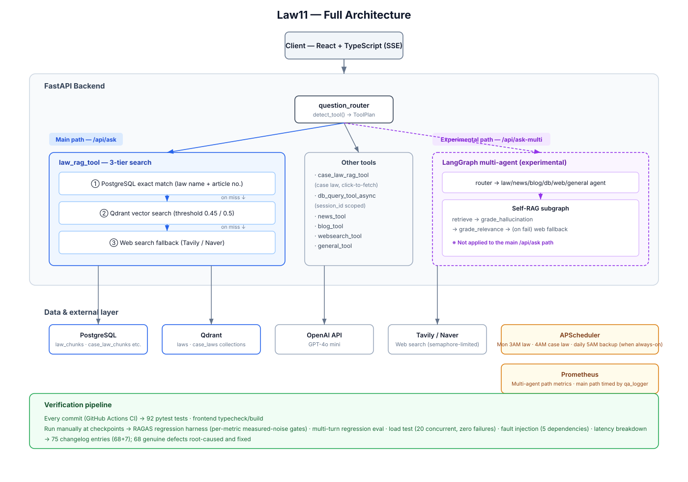

# Law11 — Korean Occupational Safety Law RAG Chatbot

> English summary. The [Korean README](README.md) is the primary document, including the full engineering changelog (96 documented find-fix cycles, plus 7 fixes that predate the changelog — see [CHANGELOG.md](CHANGELOG.md)).

[](https://github.com/codingiswine/law11/actions/workflows/ci.yml)
[](https://www.python.org/)
[](https://fastapi.tiangolo.com/)
[]()

A domain-specialized RAG system over **9 Korean occupational-safety laws (1,641 articles)**. Built on a chatbot from a startup internship the year before, then rebuilt as an independent personal project — alongside an IT-academy internship — with a measurement-first engineering process.

Pipeline: **PostgreSQL exact-match → Qdrant semantic search → GPT-4o-mini**, with SSE streaming, multi-turn sessions, citation tracking, and an experimental LangGraph Self-RAG path (`/api/ask-multi`).

A separate case-law tool runs the same retrieval chain over its own collection (**52 Supreme Court precedents across 6 of those laws**). It is deliberately click-to-fetch rather than mixed into every answer, so a law question does not pay for a second LLM call it did not ask for.

## Verified quality metrics

All numbers are reproducible from the eval scripts in this repo (30-case corrected golden set; retrieval, RAGAS and hallucination re-measured 2026-11-04 on the resynced corpus — #71, #72; the rest 2026-09-19):

> **Measurement snapshot** — Retrieval recall, RAGAS and hallucination below were **re-measured on 2026-11-04** against the resynced corpus (1,641 articles) (#71), after correcting 18 of 30 stale golden-set ground truths (#69). Router accuracy, pytest, load test and fault injection do not depend on article content.

| Metric | Value |
|---|---|
| Retrieval Top-3 recall (vector-only) | **93.3%** · Top-5/10 100% (30-case golden set, re-measured 2026-11-04 on the resynced corpus, #71; 96.7% before the resync; multi-accepted-article policy #30, statutory-term query expansion #33). The one new miss (GS-020) is caught by the PostgreSQL exact match in production — 0 new failures on the production path |
| RAGAS Faithfulness / Answer Relevancy / Context Precision / Context Recall | **0.669–0.814 / 0.606–0.616 / 0.993–0.996 / 0.918–0.929** (range over 3 runs of the same configuration, 2026-11-04 — #72; judge `gpt-4o-mini`, kept separate from the generator model — #57). Until #57 the harness generated answers with a *different* prompt and temperature than production, so earlier figures did not describe the shipped system. **Measured faithfulness noise is 19.3%** — two to three times the earlier estimate (8.45%), so a single-run comparison says nothing about that metric (#72). See the Korean README footnote 2 |
| Hallucination (golden set) | **GROUNDED 27–28/28 after statute cross-check** · **0 HALLUCINATION** (judge's raw verdict 26/28, identical across all 3 runs, 2026-11-10 — #78) | The two cases the judge flags every run (GS-004, GS-016) are dismissed because a machine check finds the flagged sentence **verbatim in the provided statute**. The dismissal also requires every number in the flagged sentence to appear in the statute and no negation absent from it — so an answer that copies an article but alters a figure, or flips its conclusion, is never dismissed (`tests/test_judge_claim_evidence.py`). Detection power is measured against 4 fabricated answers (`eval/judge_negative_controls.json`): 4/4 HALLUCINATION in all 3 runs. A repeated flag is a signal, not proof — every flag is checked against the statute text (#71's GS-024 was a real defect, fixed in #72). **Judge verdicts do not reproduce across dates**: the 27/28 recorded on 2026-11-04 came back as 25/28 when re-run on 2026-11-10 with the same input and prompt (#78). Citation misses were 0 as of 2026-11-04; the 2026-11-10 run could not verify one citation because PostgreSQL was down (`UNVERIFIED` — not a pass). 28 of the 30 golden cases are grounded in DB articles; the other 2 fall through to web search and are not scored (#61). **Scoped to the 9 laws in the DB** |
| Router accuracy | **46/46 (100%)** (keyword fast-path + LLM hybrid, incl. 11 case-law routing cases) |
| Multi-turn regression evals | 8 scenarios, each **mutation-tested** (fix reverted → eval must fail) |
| Automated tests / CI | 241 pytest cases + GitHub Actions (backend tests, frontend typecheck/build) |
| Load test | 20 concurrent users, zero failures (2× the design target) |
| Fault injection | 5 dependencies (PG, Qdrant, OpenAI, Tavily, Naver) killed individually — 4 defects found and fixed (#31) |
| Documented find-fix cycles | 96 changelog entries (symptom → root cause → measured verification), plus 7 fixes that predate the changelog |

## Engineering highlights

The [changelog](CHANGELOG.md) documents 96 find-fix cycles in "symptom → root cause → measured verification" form. Selected findings:

- **The golden dataset was lying.** Retrieval eval showed 46.7% Top-3 recall; cross-checking failures against the DB revealed the *retrieval was right and the answer key was wrong* — 13/30 golden article numbers pointed at unrelated articles (e.g., "electric shock prevention" labeled as Article 132, which is about cranes). Correcting the labels moved Top-3 recall *down* to 40.0% — the fake passes were gone — and only against an honest answer key did the real culprit surface: removing the reranker took Top-3 to 83.3% and RAGAS Faithfulness from 0.44 to 0.74. (#25)
- **193 articles were silently lost to a normalization collision.** Korean laws have branch articles (제14조**의2**, "Article 14-2"); the ingest pipeline collapsed them into the same key as their base article, and the upsert's `ON CONFLICT DO UPDATE` overwrote whichever came first — entire articles (including the one defining the national disaster response HQ) vanished without any error. On the query side the same normalization turned "제14조의2" into "142", matching Article 142. Fixed the scheme end-to-end and resynced: 1,436 → 1,629 articles, RAGAS Faithfulness 0.74 → 0.86. (#28)
- **The reranker was destroying retrieval.** An A/B/C experiment showed the English-only cross-encoder (`ms-marco-MiniLM`) reordered Korean articles near-randomly, crushing Top-1 accuracy from 66.7% to 13.3%. A multilingual CE also failed to beat plain vector order, so reranking was removed entirely — a net-negative flagship feature, deleted on evidence. (#25)
- **Evals are themselves verified.** Every multi-turn regression scenario was validated by reverting the fix it enshrines and confirming the eval fails (mutation testing). This process caught an eval that silently passed because a Docker container — not the code under test — was serving the traffic, and another that polluted its own fixtures through the chat-history table. (#20, #21)
- **Killing dependencies on purpose surfaced a hallucination path that only exists in production incidents.** With every web-search backend (Tavily, Naver) deliberately taken down, the fallback still asked GPT to "summarize the search results" — with zero results. It answered anyway, inventing a specific numeric safety standard and presenting it as legal fact. Fixed by aborting generation when the search context is empty instead of letting the model fill the gap. Also found in the same sweep: a PostgreSQL outage was reported to the user as "this article doesn't exist," misrepresenting an infrastructure failure as a data-absence fact. (#31)
- **The "10 concurrent users" assumption was load-tested for the first time** after being carried untested from the predecessor project — validated at 20 users with zero failures.
- **Laws stay current automatically**: a weekly APScheduler job syncs PostgreSQL and Qdrant from the Korean Ministry of Government Legislation (DRF) API, now with post-sync consistency checks and stale-article cleanup so law changes/repeals don't linger as silent drift. (#32)
- **The eval harness was not measuring the shipped system.** Until #57 it generated answers with a *different* prompt and temperature than production, so the RAGAS numbers described a system nobody ran. After aligning it, noise was measured first (3 runs per configuration): a prompt change moved answer relevancy by 7.6× its noise (0.542 → 0.576, reproduced 3/3) while cutting mean answer length 765 → 386 characters, but faithfulness noise (8.45% then, 19.3% on the current corpus) exceeded its gain, so no improvement is claimed for it. Regression gates are now *derived* from measured noise (2× per metric, 2% floor), and faithfulness is excluded from single-run judgment. (#57–#59, #74)
- **The answer key went stale a second time.** Six months after #25, 18 of 30 golden ground truths no longer matched current statute — one article amended in February was still graded against its old text in November, so a correct answer would have been penalized. A drift check (`eval/check_golden_drift.py`) now exits non-zero before any re-measurement. (#69)
- **Re-measuring after a corpus resync caught a regression the judge could only point at.** GS-024 (Serious Accidents Punishment Act, Article 10) was flagged 3/3: the prompt rule "state the conclusion in one or two sentences" had collapsed a two-tier penalty into one, listing both penalties under the same condition. A first fix split the list but left both items with identical condition wording; the second added a self-check — *if your items share the same condition, you dropped the one that distinguishes them* — and both GS-023 and GS-024 passed 3/3. (#71, #72)
- **A judge's repeated flag is a signal, not a verdict.** GS-004 was flagged 3/3 exactly like GS-024 — but its sentence was a verbatim copy of the statute. A deterministic cross-check now dismisses such flags (every number must match, no negation absent from the statute) and is reported *beside* the raw verdict, never in place of it. The same input and prompt also did not reproduce across dates: 27/28 on 2026-11-04, 25/28 on 2026-11-10. (#77, #78)
- **Cost falls before availability.** `/api/ask` had no rate limit, and one call spends a GPT generation, an embedding and up to 20 s of web search. The 20-user load test modelled honest users only — a script would run up the OpenAI/Tavily bill long before the server fell over. Per-IP limits via `slowapi`: 10/min on LLM routes, 60/min elsewhere, all env-configurable. (#65)

## Fixes that predate the changelog

The numbered changelog (#1–#96) starts at `v1.0.1` (2026-07-16), when the
"symptom → root cause → measured verification" format was adopted. Earlier bug fixes
exist only as commits; a later audit (`docs/defect_audit.md`) recovered them. They are
listed separately so the existing numbering stays stable.

| Commit | Date | Fix |
|---|---|---|
| [`2c8097e`](https://github.com/codingiswine/law11/commit/2c8097e) | 2026-07-05 | Paragraph/item numbers duplicated inside article text; citation badge order disagreed with the score shown on it |
| [`764b646`](https://github.com/codingiswine/law11/commit/764b646) | 2026-07-10 | Stream-completion race — a previous question's completion could fire on the next one, or a received answer could be dropped entirely; `confidence_score` read the pre-dedup top hit |
| [`ffdcb2f`](https://github.com/codingiswine/law11/commit/ffdcb2f) | 2026-07-11 | Web-fallback citations carried `score: 0.0`, rendered as a "0%" relevance badge — a false signal for "no score" |
| [`a5a5ea1`](https://github.com/codingiswine/law11/commit/a5a5ea1) | 2026-07-11 | Side panel showed a blank article-number header (the `article_number` column was NULL for every row until #28) and ran paragraph numbers into the text |
| [`2240ee5`](https://github.com/codingiswine/law11/commit/2240ee5) | 2026-07-12 | Sidebar history was always empty — the frontend sent a leftover `user_id` from the predecessor project while the backend saved another; `/api/history` also never returned `session_id` |
| [`893e0e2`](https://github.com/codingiswine/law11/commit/893e0e2) | 2026-07-12 | Redeploys did not reach users: `nginx.conf` was never copied into the image, so browsers kept a cached `index.html` pointing at old hashed bundles |
| [`9d9c230`](https://github.com/codingiswine/law11/commit/9d9c230) | 2026-08-31 | PostgreSQL (5432) and Qdrant (6333/6334) were published on `0.0.0.0` — harmless locally, but on EC2 the security group becomes the only line of defense. Rebound to `127.0.0.1` |

See the [CHANGELOG.md](CHANGELOG.md#pre-changelog-수정-이력) for the full write-up of each.

## Deployment and security (AWS EC2)

The Compose stack was deployed to AWS EC2 (t3.micro, Amazon Linux 2023) behind a security group, with separate IAM users, MFA and budget alerts; `.env` is copied over `scp`, never committed. What the deployment and the security pass turned up:

- **Pre-deploy check.** PostgreSQL (5432) and Qdrant (6333/6334) were published on `0.0.0.0` by default. FastAPI/React stay public; the data stores were rebound to `127.0.0.1` so a forgotten security-group rule cannot expose them.
- **Two deployment failures diagnosed on the box.** `docker compose up` failed with `compose build requires buildx 0.17.0 or later` — the engine was installed, the buildx plugin was not; a hard-coded release tag first downloaded a 9-byte error page, so the install was redone with a dynamic lookup of the latest release. Then the frontend showed a blank page with `crypto.randomUUID is not a function`: that API only exists in a secure context (HTTPS or localhost), and plain HTTP over an IP address is not one. Verified without a domain or certificate by SSH port-forwarding (`ssh -L 3000:localhost:3000`) so the browser saw `localhost`.
- **Session-list scope — a leak that never reproduces locally (#81).** `/api/history` filtered by `user_id`, but that value was the same constant on every request, so the sidebar was rendering **every visitor's conversations, bodies included**. With one developer and one browser there was never "someone else's chat" to notice. There is no identity model, so the browser's own session IDs (`randomUUID`) are the only evidence of ownership: the list is now queried by those IDs alone. The list endpoint not leaking IDs is the precondition the UUID-as-capability design rests on.
- **A security pass outside the framework (#91).** Traced every point where external text reaches the model or the browser, and measured dependency vulnerabilities with `pip-audit` and `npm audit`. The React + `react-markdown` frontend was safe; the one hand-written HTML page, `/api/dashboard`, put chat bodies straight into `innerHTML` — **stored XSS**: a script planted in the question box would run in the operator's browser when the dashboard opened. The conversation list was removed, the remaining fields are escaped, and nginx now sends CSP (`script-src 'self'`) and related headers. npm advisories went 19 → 9 (high/critical 0, the rest build tooling); the 20 pip advisories need fastapi/langchain major upgrades and are recorded with their fix versions.

## Architecture

<div align="center">
  
</div>

```
POST /api/ask
  → question_router  (keyword fast-path → LLM classification, session-aware)
  → tool             (law RAG / web search / news / DB history / small talk)
  → SSE stream       (text · status · source chunks + citation tracking)

law_rag_tool retrieval order:
  ① PostgreSQL exact match (law name + article number)
  ② Qdrant semantic search (text-embedding-3-large, 3072-dim, cosine top-5)
  ③ Scope gate — a question that is not a statute question at all stops here,
     before the paid web path (#79)
  ④ Web-search fallback (statute-style citation formatting, context-aware)
```

## Evaluation pipeline

| Command | What it measures |
|---|---|
| `python -m eval.harness` | RAGAS 4 metrics over the 30-case golden set, with regression compare (per-metric gates **derived** from measured noise, not hardcoded: answer relevancy 3.2%, context recall 2.2%, context precision 2.0% — each 2× that metric's measured noise with a 2% floor. Faithfulness is **excluded from single-run judgment**: its noise is 19.3%, so a 2× gate of 38.7% would catch nothing worth catching — `--repeat` only. A gate drifting below its metric's noise fails pytest, #74). `--repeat N` measures that configuration's noise first |
| `python -m eval.eval_retrieval` | Retrieval Top-1/Top-3 accuracy (embedding-only, free) |
| `python -m eval.eval_router` | Router accuracy on 46 labeled cases |
| `python -m eval.eval_hallucination` | LLM-judge groundedness + citation verification, plus a deterministic cross-check that dismisses a flag whose sentence is verbatim in the provided statute — reported *beside* the judge's raw verdict, never in place of it (#78). `--repeat N` judges the same input N times and reports a **per-case history**, separating cases flagged every run (check them against the statute) from cases whose verdict flips (an unstable judge). Repetition is a signal, not proof — #72's GS-024 repeated 3/3 and was a real defect; GS-004 repeated 3/3 and was a false flag (#77) |
| `python -m eval.eval_rubric` | **Per-item** scoring against a rubric defined per question type (penalty / direct-article / standard / concept), judged one item at a time with structured output. The product is not an average — it is *which item lost points*. Items the statute does not regulate are scored `해당없음` and excluded, never 0 (#80) |
| `python -m eval.eval_multiturn` | Multi-turn regression scenarios via the live API (mutation-tested) |

## Stack

FastAPI · PostgreSQL (asyncpg) · Qdrant · OpenAI (gpt-4o-mini, text-embedding-3-large) · LangGraph (experimental Self-RAG) · React 19 · Docker Compose · GitHub Actions

## Quick start

```bash
cp law11_backend/.env.example law11_backend/.env   # set OPENAI_API_KEY, DB_PASS
docker compose up --build                           # backend :8000, frontend :3000
docker compose exec fastapi python -m app.tools.law_updater_async --all   # load laws
```

See the [Korean README](README.md) for full architecture details and troubleshooting; [CHANGELOG.md](CHANGELOG.md) for the complete changelog, [docs/api.md](docs/api.md) for the API reference.
